# 🔐 File Hash Manifest

 

File Hash Manifest creates a portable inventory of file hashes and checks it later. It is a transparent way to notice unexpected edits or transfer corruption in a local project directory.

## 💡 Why it exists

A directory can change silently between backups, copies, or build stages. A manifest records file digests so a later verification can identify missing or modified files.

## ✨ Features

- Generate a JSON manifest of relative file paths and SHA-256 hashes.
- Verify every recorded file against its expected digest.
- Report missing and changed files separately.
- Skip the output manifest itself when it is inside the scanned directory.
- Use only pathlib, hashlib, json, and argparse from Python's standard library.

## 🧩 Architecture

The create command walks a directory and hashes each file in chunks. The verify command reads the manifest and recomputes each expected digest.

~~~text
filehash-manifest/
|-- README.md
|-- filehash_manifest.py
~~~

## ⚙️ Requirements and setup

Requires Python 3.9+. No third-party packages are needed.

## 🚀 Quick start

Create a manifest:

~~~bash
python filehash_manifest.py create ./project -o manifest.json
~~~

Verify it later:

~~~bash
python filehash_manifest.py verify manifest.json --root ./project
~~~

## 🧪 Example

If src/app.py changes after the manifest is created, verification prints CHANGED src/app.py and exits with a non-zero status.

## 🎯 Security and scope notes

A hash manifest detects differences relative to a manifest you trust. It is not a digital signature, does not prove who created the manifest, and does not protect the manifest from tampering. Store trusted manifests separately when integrity matters.

## 🗺️ Roadmap

- [ ] Add include and exclude glob patterns.
- [ ] Add streaming JSON output for very large trees.
- [ ] Add a separately documented signed-manifest workflow.

## 🤝 Contributing

Bug reports and focused pull requests are welcome. Include a small reproducible directory layout and expected verification result.

## 📄 License

No license file has been selected yet. Do not assume redistribution or reuse rights until a license is added.
